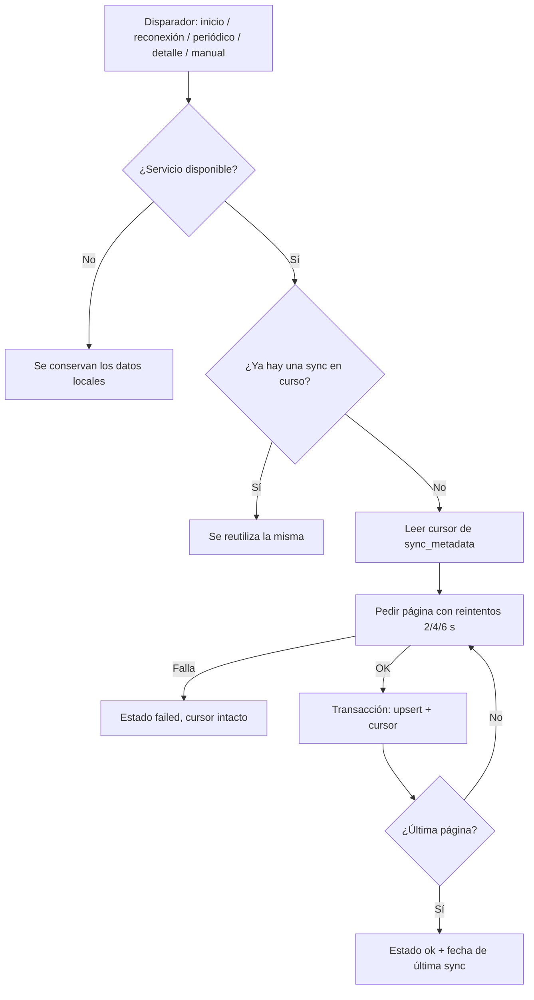

# Pokédex Offline-First

Aplicación móvil multiplataforma hecha con **Flutter** que consume la API GraphQL de **PokeAPI** y sigue funcionando con o sin Internet, gracias a una arquitectura **Offline-First con comportamiento Online-Preferred**: la interfaz siempre lee de una base de datos local y, cuando el servicio está disponible, la actualiza en segundo plano.

Proyecto final de *Desarrollo de Aplicaciones Móviles* · Escuela de Ingeniería en Computación y Telecomunicaciones · PUCMM.
Docente: Freddy Peña (fr.pena@ce.pucmm.edu.do).

**Equipo:** María José Cruz · Almy Otoniela

> **Estado de este documento: entrega final, 2-dic-2026.**
> Cada sección indica el estado de lo descrito. Las pruebas de aceptación (PA-01 a PA-16) se demuestran en vivo.

## Estado del proyecto

| Área | Estado |
|---|---|
| Estructura Clean Architecture por funcionalidades, DI con get_it y BLoC | Implementado |
| Base de datos local con Drift (19 tablas, esquema v4) | Implementado |
| Cliente GraphQL con timeout, errores tipados y reintentos con backoff | Implementado |
| Sincronización remoto → local del catálogo y del detalle, con restauración (OF-19 a OF-21) | Implementado |
| Monitor de conectividad e indicador global (4 estados) | Implementado |
| Catálogo con búsqueda, filtros por tipo y generación, orden y vista cuadrícula/lista | Implementado |
| Detalle (stats, habilidades, evoluciones, movimientos, matchups, formas, regiones) | Implementado |
| Favoritos | Implementado |
| Trivia (silueta, tiempo, pistas, ranking, logros) | Implementado |
| Accesibilidad, i18n ES/EN, tema claro/oscuro | Implementado |
| Pokémon Card compartible, Hero, mapa ilustrado de regiones, onboarding | Implementado || Área | Estado |
|---|---|
| Proyecto Flutter, linter estricto y repositorio (T-001) | Implementado |
| Estructura Clean Architecture por funcionalidades (T-002) | Implementado |
| Inyección de dependencias y BLoC (T-003) | Implementado |
| Tema Material 3 y colores por tipo (T-004) | Implementado |
| Router y shell de navegación (T-005) | Implementado |
| Cliente GraphQL con timeout y errores tipados (T-010) | Implementado |
| Contrato del repositorio y entidades del dominio | En desarrollo |
| Base de datos local con Drift (T-006 a T-008) | En desarrollo |
| Queries del catálogo y DTOs (T-011) | En desarrollo |
| Monitor de conectividad e indicador global (T-012, T-013) | En desarrollo |
| Sincronización remoto → local (T-014) | En desarrollo |
| Catálogo con estados de carga, vacío y error (T-015, T-016) | En desarrollo |
| Detalle, favoritos, búsqueda y filtros, trivia, resiliencia completa | Planificado (entrega final) |

## 1. Descripción del proyecto

La app permite consultar el catálogo de Pokémon, ver el detalle de cada uno, gestionar favoritos, buscar y filtrar, y jugar una trivia, **tanto con conexión como sin ella**.

Principios que guían el diseño:

- **Fuente de verdad local.** La interfaz solo observa la base de datos; las respuestas de la red nunca se muestran directamente.
- **Online-Preferred.** Si el servicio está disponible, se actualiza sin bloquear la navegación.
- **Degradación segura.** Un fallo remoto nunca borra datos locales válidos.
- **Transparencia.** El usuario sabe en todo momento el estado de la conexión y la vigencia de los datos.

Los datos del usuario (favoritos, resultados de trivia) viven solo en el dispositivo. PokeAPI es una fuente de solo lectura y no hay backend propio.

## 2. Requisitos de ejecución

- Flutter SDK (canal estable) con su versión de Dart. Versión usada: `3.47.7`.
- Android SDK y un dispositivo Android físico o un emulador.
- Conexión a Internet **en la primera ejecución** para descargar el catálogo. Después funciona sin conexión.
- iOS: el código es multiplataforma, pero el equipo desarrolló en Windows y **no se pudo compilar ni probar en iOS** (ver Limitaciones).

## 3. Instrucciones de instalación

```bash
git clone https://github.com/mariajose12-alt/icc451-pokedex
cd pokedex
flutter pub get
dart run build_runner build --delete-conflicting-outputs   # genera el código de Drift
flutter devices
flutter run -d <id-del-dispositivo>
```

Comprobaciones de calidad:

```bash
flutter analyze                          # debe salir sin advertencias
dart format --set-exit-if-changed .      # debe salir sin cambios
flutter test
```

> Android necesita el permiso `INTERNET` en `android/app/src/main/AndroidManifest.xml`. El template de Flutter solo lo trae en las compilaciones de depuración.

## 4. Tecnologías utilizadas y su justificación

| Paquete | Para qué se usa | Por qué |
|---|---|---|
| `flutter_bloc`, `equatable` | Gestión de estado | Flujo explícito evento → estado, estados comparables y fáciles de probar. Ver [ADR-0002](docs/adr/0002-bloc-y-get-it.md) |
| `get_it` | Inyección de dependencias | Contenedor simple; las dependencias llegan por constructor y son sustituibles (RNF-MAN-03) |
| `go_router` | Navegación | Rutas declarativas y shell con estado por pestaña (sin parpadeos) |
| `graphql` | Cliente GraphQL de PokeAPI | Cliente de Dart puro, sin widgets que acoplen la UI a la red. Ver [ADR-0004](docs/adr/0004-cliente-graphql.md) |
| `connectivity_plus` | Cambios de red | Avisa de cambios de red; **no** prueba que la API responda, para eso hay una verificación activa |
| `drift`, `drift_dev`, `build_runner`, `sqlite3_flutter_libs`, `path_provider`, `path` | Base de datos local | SQLite con consultas tipadas, streams reactivos e índices. Ver [ADR-0001](docs/adr/0001-drift-fuente-de-verdad.md) |
| `cached_network_image`, `flutter_cache_manager` | Imágenes en disco | Las imágenes ya vistas se ven sin conexión, con caché acotada |
| `shared_preferences` | Preferencias | Filtros y orden entre sesiones |
| `intl` | Internacionalización | Español e inglés |
| `flutter_lints` (dev) | Calidad de código | Linter estricto (`strict-casts`, `strict-inference`, `strict-raw-types`) |
| `bloc_concurrency` | Concurrencia en los Blocs | `droppable()` evita lanzar dos actualizaciones a la vez desde la UI |
| `skeletonizer` | Esqueletos de carga | Estado de carga visible sin bloquear la interfaz |
| `share_plus` | Compartir la Pokémon Card | Comparte la tarjeta como imagen (RF-COM-01) |
| `file` | Sistema de archivos abstracto | Permite probar la caché de imágenes sin disco real |
| `flutter_launcher_icons`, `fake_async` (dev) | Ícono de la app y pruebas con tiempo simulado | Pruebas de reintentos y temporizadores sin esperas reales |

Decisión sobre tipografías: **no se usa `google_fonts`**, porque descarga las fuentes por red y rompería el funcionamiento offline.

## 5. Arquitectura

Clean Architecture organizada por funcionalidades. Las dependencias apuntan hacia el dominio. Ver [ADR-0005](docs/adr/0005-clean-architecture-por-features.md).

```text
 PokeAPI (GraphQL)
        │  solo escribe en la base local
        ▼
 core/network ─► DTO + mapeador ─► Repositorio (data) ─► Drift / SQLite
                                                            │  Stream
                                                            ▼
        Contrato del repositorio (domain) ─► Bloc ─► Widget (presentation)
```

| Capa | Responsabilidad | No puede |
|---|---|---|
| `presentation` | Pantallas, widgets, Blocs, estados | Acceder al cliente GraphQL ni a la base de datos |
| `domain` | Entidades, contratos de repositorio, reglas | Depender de Flutter, GraphQL o Drift |
| `data` | Repositorios, DTO, mapeadores, fuentes de datos | Exponer DTO a la presentación |

El detalle completo del funcionamiento está en [docs/decisiones-y-funcionamiento.md](docs/decisiones-y-funcionamiento.md).

## 6. Estructura del proyecto

```text
lib/
  main.dart                      raíz de composición (registro de dependencias)
  app/
    app.dart                     MaterialApp.router
    router/                      rutas (go_router) y shell con barra de navegación
    theme/                       tema Material 3 y colores por tipo
  core/
    di/                          contenedor get_it y observador de Blocs
    network/                     cliente GraphQL, configuración y excepciones tipadas
    database/                    base Drift y tablas
    connectivity/                monitor de conectividad real
    sync/                        coordinador de sincronización
    errors/                      fallos del dominio (Failure)
  features/
    pokemon/        presentation/ domain/ data/
    favorites/      presentation/ domain/ data/
    trivia/         presentation/ domain/ data/
    settings/       presentation/ domain/ data/
    onboarding/     presentation/ domain/ data/
docs/
  adr/                           registros de decisiones de arquitectura
  decisiones-y-funcionamiento.md
```

## 7. Estrategia Offline-First

**Estado: Implementado.**

1. La interfaz **solo** observa un `Stream` de la base local (a través del repositorio).
2. Las respuestas de GraphQL se validan y se guardan en la base; la UI se actualiza porque la base emite el cambio.
3. La app abre de inmediato (estado de carga o vacío) y nunca bloquea la navegación mientras sincroniza.
4. Sin conexión funcionan catálogo, detalle, búsqueda, filtros, favoritos y trivia con los datos ya descargados.
5. Un error remoto nunca elimina ni sobrescribe datos locales válidos.
6. El catálogo completo **no** se descarga obligatoriamente en la primera ejecución; se hace en segundo plano y de forma progresiva.

Esto no es una caché HTTP: los datos están estructurados (entidades, relaciones, índices), las consultas nuevas funcionan sin red y los datos del usuario forman parte del mismo modelo local.

## 8. Uso de GraphQL y estrategia de paginación

**Estado: cliente Implementado; queries Implementado.**

- Endpoint: `https://graphql.pokeapi.co/v1beta2` (solo acepta POST).
- Timeout explícito de **20 s** por solicitud.
- La caché del cliente está desactivada (`FetchPolicy.noCache`): la verdad es la base local.
- Se piden **solo los campos necesarios**. Las URLs de imagen se extraen con el argumento `path` en lugar de pedir el bloque completo de sprites.

Consulta del catálogo (paginada por cursor de id):

```graphql
query CatalogPage($lastId: Int!, $pageSize: Int!) {
  pokemon(
    where: {is_default: {_eq: true}, id: {_gt: $lastId}}
    order_by: {id: asc}
    limit: $pageSize
  ) {
    id
    name
    height
    weight
    pokemonsprites {
      artwork: sprites(path: "other.official-artwork.front_default")
      sprite: sprites(path: "front_default")
    }
    pokemontypes { slot type { id name } }
    pokemonspecy { id generation_id }
  }
  pokemon_aggregate(where: {is_default: {_eq: true}}) { aggregate { count } }
}
```

**Paginación: cursor por id, páginas de 250.** El catálogo (1025 Pokémon) se descarga en 5 llamadas, muy por debajo del límite de 100 solicitudes por hora por IP que documenta PokeAPI. Se justifica en el [ADR-0003](docs/adr/0003-sincronizacion-cursor-y-upsert.md).

Errores diferenciados (excepciones tipadas): sin conexión, timeout, límite de solicitudes, error de servidor, errores GraphQL (incluidas respuestas parciales) y errores inesperados.

## 9. Estrategia de sincronización

**Estado: Implementado.**

- Dirección única: **remoto → local**. PokeAPI es la autoridad del catálogo; favoritos, trivia y logros no se sincronizan ni se sobrescriben (OF-21).
- **Catálogo:** páginas de 250 por cursor de id; cada página y su cursor se guardan en **una transacción**. Si se interrumpe, se reanuda desde el cursor (PS-07).
- **Detalle:** se descarga al abrir el Pokémon, con 10 s mínimo entre consultas del mismo id.
- **Sin duplicados:** upsert por el id de PokeAPI (nunca `insertOrReplace`).
- **Reintentos:** backoff exponencial de 2, 4 y 6 s (máximo 3 reintentos) en catálogo y detalle.
- **Concurrencia:** una sola sincronización a la vez por recurso; las demás reciben el mismo `Future`.
- **Disparadores:** al iniciar (si el catálogo tiene más de 10 min), al reconectar (separación mínima de 2 min), al abrir el detalle, cada 15 min si el servicio está Online y manualmente desde Ajustes.
- **Restauración (OF-19):** cada sync sobrescribe con el dato remoto. Al guardar un detalle se compara nombre y tipos y la diferencia queda en el log (`Integridad: #id difiere…`). Ver [ADR-0014](docs/adr/0014-integridad-del-catalogo-y-online-preferred.md).



## 10. Persistencia local

**Estado: Implementado.**

Base SQLite con Drift, esquema v4, con 19 tablas:

| Grupo | Tablas |
|---|---|
| Catálogo | `pokemons`, `poke_types`, `pokemon_types`, `pokemon_stats`, `type_efficacies` |
| Detalle | `abilities`, `pokemon_abilities`, `pokemon_egg_groups`, `pokemon_forms`, `pokemon_form_types`, `evolution_nodes`, `moves`, `version_groups`, `pokemon_moves` |
| Datos del usuario | `favorites`, `trivia_results`, `trivia_answers`, `trivia_achievements` |
| Control | `sync_metadata` (última sync, estado y cursor por recurso) |

```mermaid
erDiagram
    POKEMONS {
        int id PK
        text name
        int national_dex_number UK
        int generation_id
        int height
        int weight
        text artwork_url
        text sprite_url
        text artwork_local_path
        datetime updated_at
    }
    POKE_TYPES {
        int id PK
        text name UK
    }
    POKEMON_TYPES {
        int pokemon_id PK,FK
        int slot PK
        int type_id FK
    }
    POKEMON_STATS {
        int pokemon_id PK,FK
        int stat_id PK
        int base_stat
    }
    ABILITIES {
        int id PK
        text name
        text effect_summary
    }
    POKEMON_ABILITIES {
        int pokemon_id PK,FK
        int ability_id PK,FK
        bool is_hidden
    }
    POKEMON_EGG_GROUPS {
        int pokemon_id PK,FK
        text egg_group PK
    }
    MOVES {
        int id PK
        text name
    }
    VERSION_GROUPS {
        int id PK
        text name
    }
    POKEMON_MOVES {
        int pokemon_id
        int version_group_id FK
        int learn_method_id
        int move_id FK
        int level
    }
    EVOLUTION_NODES {
        int chain_id PK
        int species_id PK
        int from_species_id
        text trigger
    }
    POKEMON_FORMS {
        int id PK
        int species_id
        text name
        bool is_default
    }
    POKEMON_FORM_TYPES {
        int form_id PK
        int slot PK
        int type_id
    }
    TYPE_EFFICACIES {
        int damage_type_id PK
        int target_type_id PK
        int damage_factor
    }
    FAVORITES {
        int pokemon_id PK,FK
        datetime created_at
    }
    TRIVIA_RESULTS {
        int id PK
        int score
        int correct_answers
        int total_questions
        int hints_used
        datetime played_at
    }
    TRIVIA_ANSWERS {
        int id PK
        int trivia_result_id FK
        int pokemon_id FK
        bool correct
        int milliseconds_used
        int hints_used
        int points
    }
    TRIVIA_ACHIEVEMENTS {
        text id PK
        datetime unlocked_at
    }
    SYNC_METADATA {
        text resource_key PK
        datetime last_successful_at
        text status
        text cursor_or_offset
    }

    POKEMONS ||--o{ POKEMON_TYPES : "tiene"
    POKE_TYPES ||--o{ POKEMON_TYPES : "es"
    POKEMONS ||--o{ POKEMON_STATS : "tiene"
    POKEMONS ||--o{ POKEMON_ABILITIES : "tiene"
    ABILITIES ||--o{ POKEMON_ABILITIES : "es"
    POKEMONS ||--o{ POKEMON_EGG_GROUPS : "pertenece"
    POKEMONS ||--o{ POKEMON_MOVES : "aprende"
    MOVES ||--o{ POKEMON_MOVES : "es"
    VERSION_GROUPS ||--o{ POKEMON_MOVES : "en"
    POKEMONS ||--o| FAVORITES : "marcado"
    TRIVIA_RESULTS ||--o{ TRIVIA_ANSWERS : "contiene"
    POKEMONS ||--o{ TRIVIA_ANSWERS : "pregunta"
    POKEMON_FORMS ||--o{ POKEMON_FORM_TYPES : "tiene"
```


**Nota de diseño.** `evolution_nodes`, `pokemon_forms`, `pokemon_form_types`, `type_efficacies` y `pokemon_moves.pokemon_id` se relacionan por identificadores de PokeAPI (id de especie, de cadena o de tipo) sin clave foránea declarada: llegan por consultas distintas y una FK obligaría a un orden de inserción que no controlamos. `pokemon_moves.pokemon_id` tampoco tiene FK, así que al borrar un Pokémon sus movimientos no se borran en cascada. `favorites` y `trivia_answers` referencian a `pokemons` **sin cascada**, a propósito: los datos del usuario no se pierden si una fila del catálogo se reemplaza (OF-21).

Los datos del usuario nunca se tocan al sincronizar.
Las tablas de movimientos, habilidades, evoluciones y trivia se agregan en la entrega final.

## 11. Gestión de conectividad

**Estado: Implementado.**

- La disponibilidad del servicio y la sincronización son **dos dimensiones independientes** y se modelan por separado.
- El estado Online se decide con una **verificación activa de la API**, no solo con la presencia de red.
- Un indicador global y fijo (en el shell de navegación) muestra el estado con texto, icono y etiqueta de accesibilidad:
  `Online` · `Offline` · `Servicio no disponible` · `Sincronizando`, además del origen y la vigencia de los datos.
- El monitor comprueba la API activamente; con el servicio Online repite la comprobación cada 5 min y, tras una caída, reintenta a 30 s, 1, 2 y 5 min.
- En **Ajustes** hay un simulador de caída de la API para demostrar el estado «Servicio no disponible» con red activa (PA-08).

## 12. Funcionalidades adicionales implementadas

**Estado: Implementado.** Tema claro y oscuro (ADR-0015), español/inglés, Pokémon Card compartible, animaciones Hero y microinteracciones, mapa ilustrado de regiones (ADR-0016), onboarding, vista cuadrícula/lista y trivia con ranking, logros y pistas.

## 13. Limitaciones conocidas

- **Límite de PokeAPI:** 100 solicitudes por hora por IP. Si varios dispositivos comparten una red, pueden agotarla.
- **Señal del límite de solicitudes sin verificar:** se asume que PokeAPI responde con HTTP 429, pero no se pudo comprobar sin gastar la cuota.
- **Reinicio diario del servicio:** PokeAPI se reinicia a la 1:00 UTC (9 pm en República Dominicana) con unos 2 minutos sin servicio.
- **iOS no probado:** el desarrollo se hizo en Windows.
- **Primera ejecución sin Internet:** no hay datos; se muestra un estado vacío explicativo.
- El catálogo se descarga progresivamente: al inicio puede ser parcial y la interfaz lo indica.

## 14. Flujo de trabajo y calidad

- Una rama por tarea (`feature/T-xxx-descripcion`) y *pull request* revisado por la otra integrante.
- Una *issue* por tarea del plan.
- `flutter analyze` sin advertencias y `dart format` sin cambios antes de cada commit.
- Definición de hecho (DoD) en la planificación: capas respetadas, estados explícitos, accesibilidad (Semantics, contraste 4.5:1, objetivos de 48 dp, texto al 200%), pruebas offline y revisión cruzada.

## 15. Declaración de uso de herramientas de IA

El equipo utilizó **Claude (Anthropic)** como asistente para analizar los requisitos, planificar tareas, revisar decisiones de arquitectura y generar borradores de código y documentación. Todo el código fue revisado y adaptado por el equipo, que es responsable de él y puede explicar cualquier parte. Las dependencias de terceros están listadas en la sección 4.

## 16. Documentación

- [Decisiones y funcionamiento](docs/decisiones-y-funcionamiento.md)
- [Registros de decisiones de arquitectura (ADR)](docs/adr/README.md)

## Créditos y aviso legal

Proyecto académico sin fines comerciales. Los datos provienen de [PokéAPI](https://pokeapi.co). Pokémon y sus marcas pertenecen a sus respectivos propietarios.
